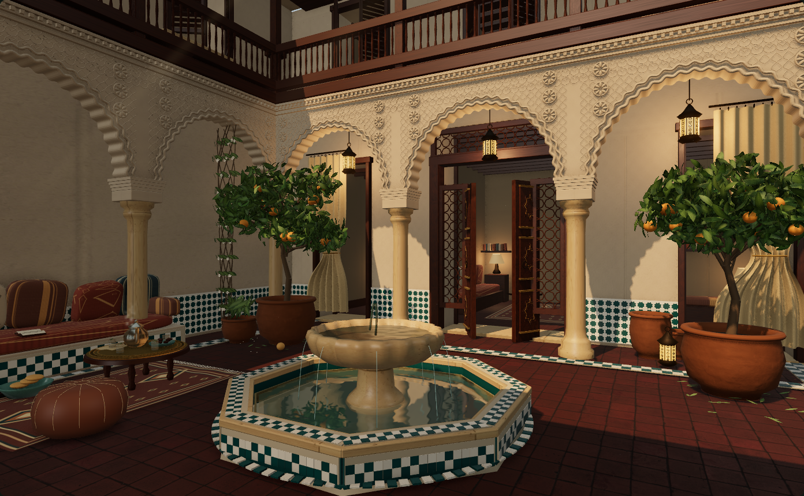

# Diorama Atlas

**A world of small places, explored from the inside.**

Culture lives in ordinary spaces: a courtyard that turns heat into shade,
a workshop that holds generations of knowledge, a café that makes time for
listening. Diorama Atlas invites you to slow down and notice those relationships.
Exploring unfamiliar ways of building, working and welcoming others can enrich
how we understand the world—and the places we call our own.

**[Enter the Atlas →](https://paulosalem.github.io/diorama-atlas/)**

**v1.0.0 · 26 dioramas · 22 geographic settings · English & Brazilian Portuguese**

[](https://paulosalem.github.io/diorama-atlas/?scene=riad&inspect=1)

## A little closer

Move from a Kyoto listening café to a Newar pottery square, from an Oaxacan loom
to a Balinese hillside or a sunlit Douro vineyard. Look through doorways, study worn timber and printed
pages, follow a guided voice, or linger with the sounds of a place.

The collection offers **602 OpenAI recordings in English and Brazilian Portuguese**,
covering original viewpoints, object details and Miniatures, alongside gentle
movement, music and local ambience.
Every place also has a **Miniature** experience: turn two floating landscape
sections in your hands, or crack open an interior's architectural shell to
reveal its rooms. Detailed roofs and facades lift up and sideways, leaving the
furnished spaces, real passageways and signs of ordinary life below.
Douro includes a working yard, riverside railway and eleven Miniature views.
Alfama adds winding stair lanes, closely joined houses and everyday street life,
with a paired sectioned miniature and bilingual guided passages.
The [Roman domus](https://paulosalem.github.io/diorama-atlas/?scene=roman-domus&version=interior)
connects 21 walkable spaces around an atrium and cultivated peristyle garden.
Its [architectural miniature](https://paulosalem.github.io/diorama-atlas/?scene=roman-domus&version=miniature)
reveals the same furnished household beneath a lift-away roof.
The [Mongolian ger](https://paulosalem.github.io/diorama-atlas/?scene=mongolian-ger&version=interior)
connects portable timber-and-felt construction with household warmth and hospitality.
Its [opening miniature](https://paulosalem.github.io/diorama-atlas/?scene=mongolian-ger&version=miniature)
shares the same lattice, roof crown, stove, furnishings and immediate grassland.
Every Listen control uses a local recording, never the browser's synthetic voice.
Everything needed to visit is included: **no account, installation or API key**.
Use a modern browser with WebGL 2 and hardware acceleration.

These are **imagined, culturally informed places**, not replicas of landmarks
or definitive portraits of entire cultures. Their purpose is curiosity, not
substitution: an invitation to learn from the people, histories and traditions
behind the scene. [Browse the collection and its briefs](docs/scenes/README.md).

## How the places are made

**Three.js and WebGL 2** render real, programmatically constructed 3D spaces:
connected rooms, shaped objects, physically based materials, scanned textures,
shadows, reflections and atmospheric light. Licensed photographs guide regional
character; they are not flat backdrops pretending to be architecture.

**Web Audio** composes recorded soundscapes. **OpenAI text-to-speech** was used
to prerecord the bilingual guide; selected reference artwork and saved scene
definitions also have documented AI provenance. Visiting never calls a paid
generation service. Native JavaScript modules run the interface; a small
**Node.js** server supports local development, and **GitHub Pages** hosts the
complete static collection. [Architecture and provenance](docs/README.md).

## Run locally

With Node.js **22.13+ on 22.x, or 24+**:

```sh
npm ci
npm start
# Open http://127.0.0.1:4183
```

Every experience, including all miniatures, builds directly from its
authored Three.js geometry. Startup needs no scene export or headless browser.

Music and ambience default to enabled; first-time playback waits for **Resume**
in Soundscape. Saved mute choices are respected. Narration starts with **Play**.
[Visitor guide](docs/visiting.md) · [Development guide](docs/development.md)

## Continue the project

Diorama Atlas is developed through **agentic methods**, with AI agents researching,
implementing and reviewing the experience under human creative direction.
Scene briefs, explicit quality standards and reusable skills guide future agents
and contributors along the same path.

[Philosophy](docs/philosophy.md) ·
[Diorama quality standard](docs/diorama-standard.md) ·
[Contributing](CONTRIBUTING.md) ·
[Agent skills](docs/agent-skills.md) ·
[v1.0.0 release notes](CHANGELOG.md)

Created by **[Dr. Paulo Salem](https://www.paulosalem.com/)**.
Source and media have distinct rights; see [credits and licensing](docs/assets.md).
